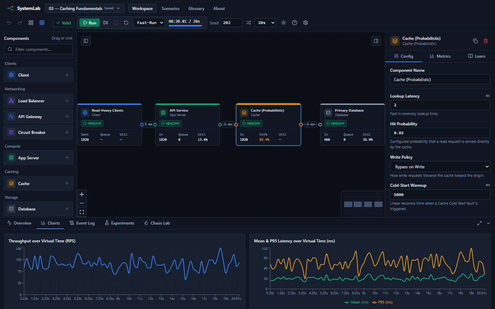
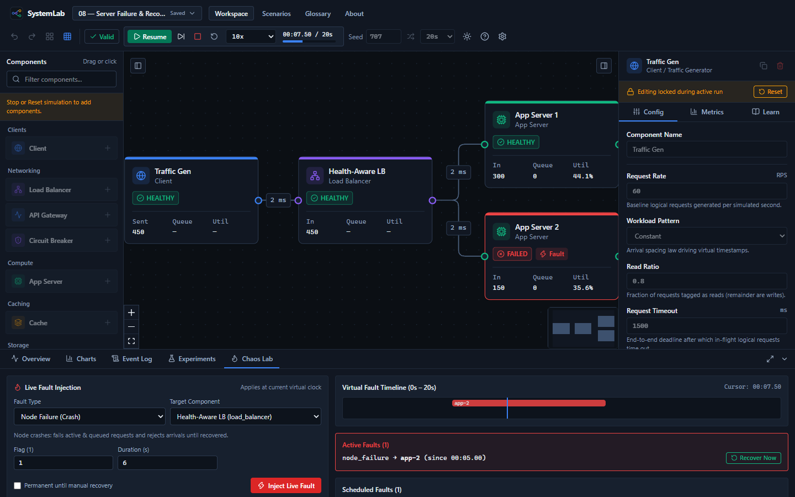
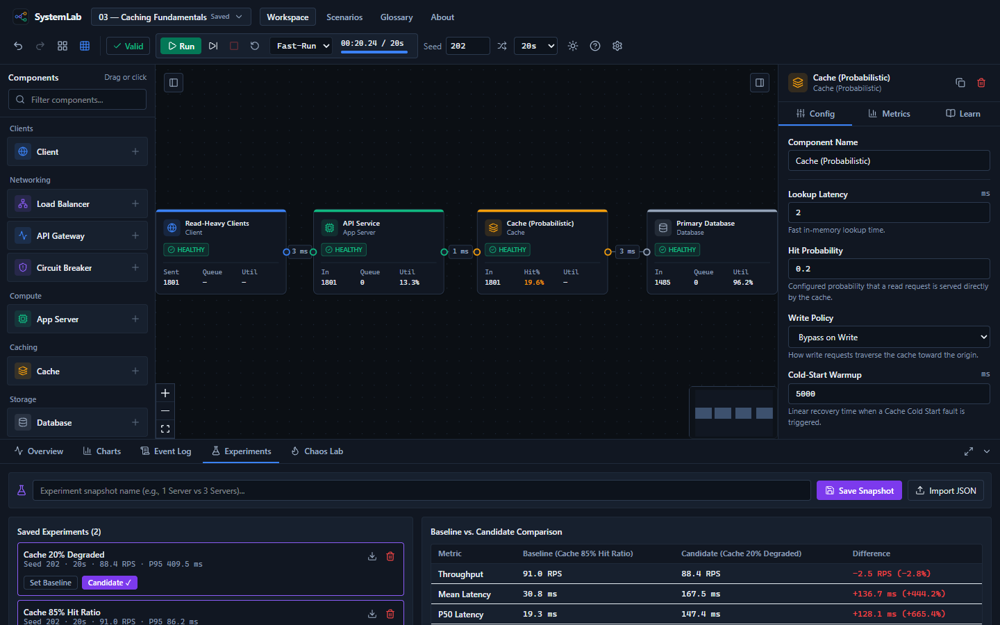

# SystemLab

**Design. Simulate. Break. Understand.**

An interactive, local-first distributed systems and system design simulation playground built for computer science students, learners, and software engineers.

---

## Overview

SystemLab bridges the gap between static architecture diagram editors and heavy production load-testing clusters. Every component on the canvas executes inside a pure TypeScript **discrete-event simulation (DES) kernel** running off the main thread in a Web Worker, driven by a monotonic virtual clock (`VirtualClock`), a binary min-heap scheduler (`MinHeap`), and a deterministic seeded PRNG (`SplitMix32` -> `xoshiro128**`).

No backend database, user account, API key, or external AI service is required.


---

## Why SystemLab Exists

1. **Static diagrams cannot show dynamics:** Drawing a Load Balancer or Cache in a diagramming tool does not reveal how tail latency reacts when database connection pools saturate or cache hit ratios drop.
2. **Production infrastructure is slow for conceptual iteration:** Spinning up containers and load generators takes minutes per topology change; SystemLab lets learners test hypotheses in seconds directly in a browser tab.
3. **Reproducibility matters:** Every experiment stores its topology snapshot, random seed, horizon, engine version, and fault schedule so architectures can be compared fairly side-by-side.

---

## Core Features

- **Pure Deterministic DES Engine (`src/engine/`):** Monotonic virtual clock, `(timestampMs, priority, sequence)` tie-breaking, exact time-weighted utilization integrals, R-7 percentile interpolation, and strict logical request conservation (`generated === succeeded + failed + timedOut + inFlight`).
- **10 Simulated Component Models:** Client / Traffic Generator (`constant`, `poisson`, `bursty`, `ramp`, `step`), Load Balancer (`round_robin`, `random`, `least_in_flight`, health-aware), API Gateway (Token Bucket rate limiter + read/write routing split), Application Server (bounded worker pool + FIFO queue + bounded local retries), Probabilistic Cache, Primary Database, Message Queue (`async_ack` / `sync_wait`), Background Worker, Circuit Breaker (`CLOSED` / `OPEN` / `HALF-OPEN`), and Read Replica.
- **Architecture Graph Editor (`@xyflow/react`):** Drag-and-drop & click-to-add palette, directional edges with propagation delay and read/write route labels, Dagre auto-layout, snap-to-grid, 50-step undo/redo, context menu, keyboard shortcuts, and blocking/non-blocking DAG validation.
- **Real-Time Telemetry & Observability:** Live KPIs (`Mean`, `P50`, `P95`, `P99`, showing `—` when unpopulated), sortable per-node table, Recharts virtual-time charts, bounded 500-event log, hop-by-hop Request Trace modal, and sampled SVG edge traffic indicators honoring `prefers-reduced-motion`.
- **Chaos Lab Fault Injection:** Manual live fault injection/recovery and scheduled fault timelines (`node_failure`, `latency_spike`, `capacity_drop`, `traffic_spike`, `packet_drop`, `cache_cold_start`, `edge_latency_spike`, `edge_failure`).
- **Experiment Studio:** Save immutable snapshots, compare Baseline vs. Candidate deltas, and receive automatic fairness warnings whenever seeds, horizons, or workloads differ.
- **Local-First Persistence:** IndexedDB workspace & experiment storage via Dexie, autosave, and prototype-pollution-safe, Zod-validated JSON import/export (2 MB cap).







---

## Quick Start

**Prerequisites:** Node.js `20+` (verified on `v24.14.0`) and npm `10+`.

```bash
git clone <your-repository-url>
cd SystemLab
npm ci
npm run dev
```

Open the local URL printed by Vite (`http://localhost:5173`) in your browser.

---

## Built-in Scenarios

| # | Scenario | Focus |
|---|---|---|
| 01 | Hello, System Design | Arrival rate, fixed service time, utilization, and request lifecycle |
| 02 | Horizontal Scaling | Round-Robin vs. Least-In-Flight distribution across 3 app servers |
| 03 | Caching Fundamentals | Probabilistic cache hit impact on database utilization and P95 latency |
| 04 | Database Bottleneck | How narrow DB connection pools bottleneck stateless application scaling |
| 05 | Rate Limiting | Token Bucket load shedding during periodic traffic bursts |
| 06 | Asynchronous Processing | `async_ack` HTTP response latency vs. background worker job completion |
| 07 | Traffic Spike & Backpressure | Step-load spike crossing cluster capacity and bounded queue drops |
| 08 | Server Failure & Recovery | Scheduled server crash, health-aware failover, and recovery |
| 09 | Circuit Breaker Protection | `CLOSED -> OPEN -> HALF-OPEN -> CLOSED` resilience transitions |
| 10 | Read / Write Split | API Gateway routing reads to Read Replicas and writes to Primary DB |

---

## Architecture Overview

- `src/engine/` — Pure TypeScript DES kernel (zero React, DOM, timer, or `Math.random` dependencies, enforced via ESLint).
- `src/workers/` — ES Module Web Worker (`simulation.worker.ts`) with monotonic `runId` race protection and automatic main-thread fallback.
- `src/store/` — Fine-grained Zustand stores (`workspaceStore`, `simulationStore`, `experimentStore`).
- `src/schemas/` & `src/features/persistence/` — Zod schema validation (`schemaVersion: 1`), prototype-pollution key sanitization, and Dexie IndexedDB storage.
- `src/features/` & `src/app/` — Canvas editor, Inspector, Telemetry charts, Chaos Lab, Experiment Studio, Scenarios, Glossary, and Guided Tutorial.

See [Architecture Documentation](docs/architecture/ARCHITECTURE.md) and [ADRs](docs/adr/ADR-001-local-first-architecture.md).

---

## Simulation Model & Reproducibility

Virtual simulation time (`VirtualClock`, ms) is the single source of truth. Changing UI playback speed (`0.25x` to `Fast-Run`) or telemetry batch size only paces wall-clock wall rendering and never alters discrete-event timestamps or random draws (`SplitMix32` -> `xoshiro128**`). Metrics reservoir sampling uses an isolated `rng.fork('metrics-reservoir')` stream so sampling never perturbs simulation traffic.

Details and analytical proofs are documented in [Simulation Engine Specification](docs/architecture/SIMULATION_ENGINE.md) and [Simulation Validation](docs/verification/SIMULATION_VALIDATION.md).

---

## Technology Stack

- **UI & Graph:** React 19, TypeScript (strict), `@xyflow/react`, `@dagrejs/dagre`, Tailwind CSS v4, Radix UI, Lucide React, Recharts
- **State & Storage:** Zustand, Dexie (IndexedDB), Zod
- **Build & Tooling:** Vite 8, ESLint 10, Prettier, Vitest 5 (`@vitest/coverage-v8`), React Testing Library, Playwright

---

## Testing & Verification

```bash
npm run lint           # ESLint + strict src/engine/ purity checks
npm run typecheck      # TypeScript strict type checking
npm run test           # Unit, analytical (Tests A-H), schema & integration suites
npm run test:coverage  # V8 coverage check (src/engine/ >= 85% lines, >= 80% branches)
npm run test:e2e       # Playwright Chrome E2E workflow suite (after npm run build)
npm run benchmark      # Deterministic DES engine benchmarks
npm run build          # Typecheck + production Vite bundle
```

Measured test, coverage, and security findings are available in:
- [Simulation Validation](docs/verification/SIMULATION_VALIDATION.md)
- [Test Report](docs/verification/TEST_REPORT.md)
- [Security Review](docs/verification/SECURITY_REVIEW.md)

---

## Performance

Measured locally on Windows 11 (`Node v24.14.0`, seed `42`):

| Workload | Topology | Wall Time | Throughput |
|---|---|---|---|
| 1,000 requests | 2 nodes, 1 edge | 14.98 ms | 253,798 events/sec |
| 10,000 requests | 6-node 3-tier | 88.75 ms | 806,278 events/sec |
| 100,000 requests (stretch) | 6-node 3-tier | 853.15 ms | 849,339 events/sec |
| 5,000 requests | 25-node, 43-edge | 43.64 ms | 925,985 events/sec |

See [Performance Report](docs/verification/PERFORMANCE_REPORT.md).

---

## Limitations

SystemLab is an **educational simulation playground**, not a production capacity-planning oracle or load-testing replacement. Key simplifications include DAG-only forwarding topologies, probabilistic cache hit trials (no key-level LRU eviction), abstract edge latencies (no TCP/TLS modeling), and open-loop traffic generation. Read the full list in [Known Limitations](docs/KNOWN_LIMITATIONS.md).

---

## Documentation Links

- [User Guide](docs/guides/USER_GUIDE.md)
- [Developer Guide](docs/guides/DEVELOPER_GUIDE.md)
- [Scenario Authoring](docs/guides/SCENARIO_AUTHORING.md)
- [Deployment Guide](docs/guides/DEPLOYMENT_GUIDE.md)
- [Data Model](docs/architecture/DATA_MODEL.md)
- [Product Research](docs/research/PRODUCT_RESEARCH.md)

---

## Contributing

Contributions, bug reports, and scenario proposals are welcome. Please read [CONTRIBUTING.md](CONTRIBUTING.md) before opening a pull request.

---

## Roadmap

See [docs/ROADMAP.md](docs/ROADMAP.md) for planned P1/P2 enhancements such as stateful LRU cache eviction modeling, multi-client groups, and optional replication lag models.

---

## License

Released under the [MIT License](LICENSE).
