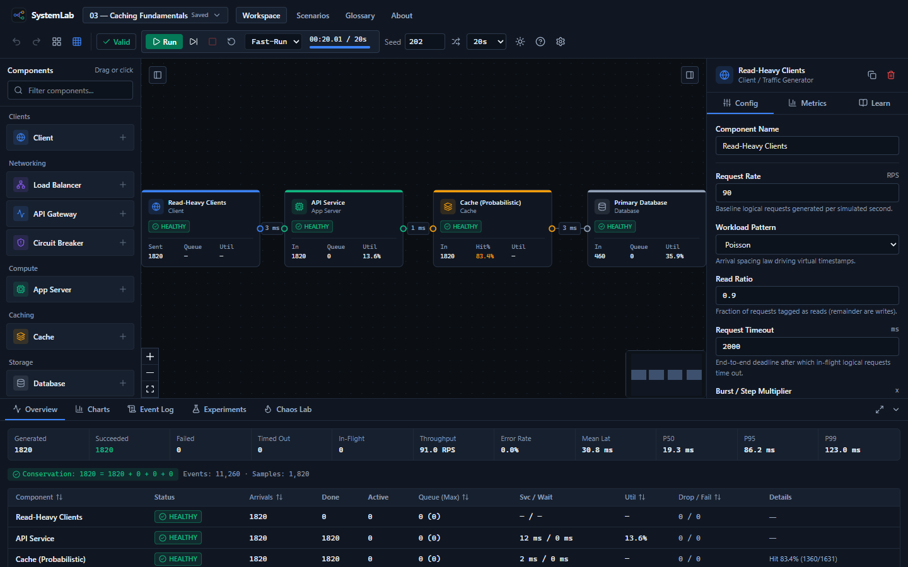
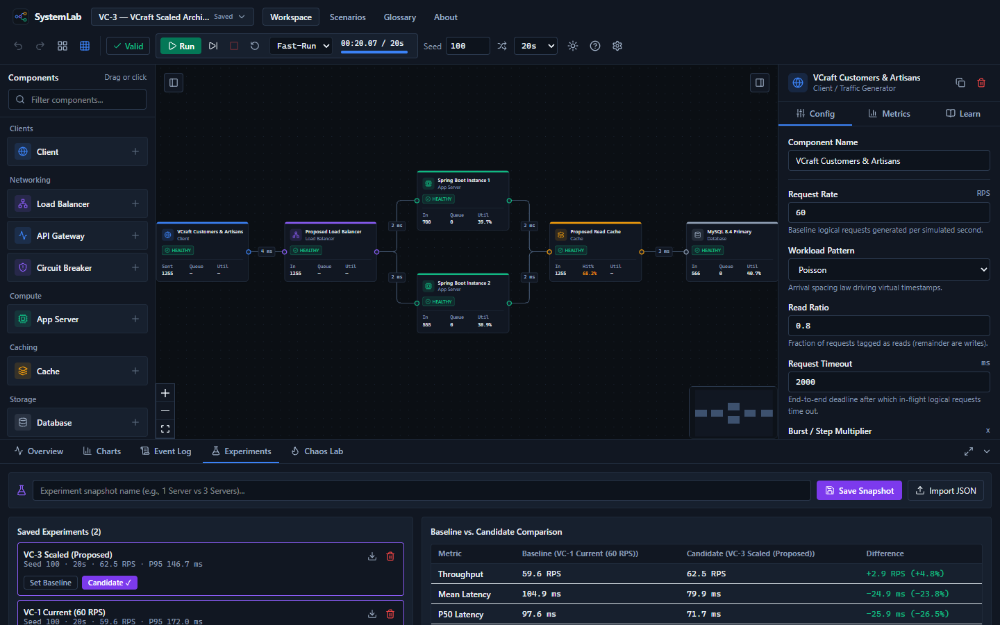
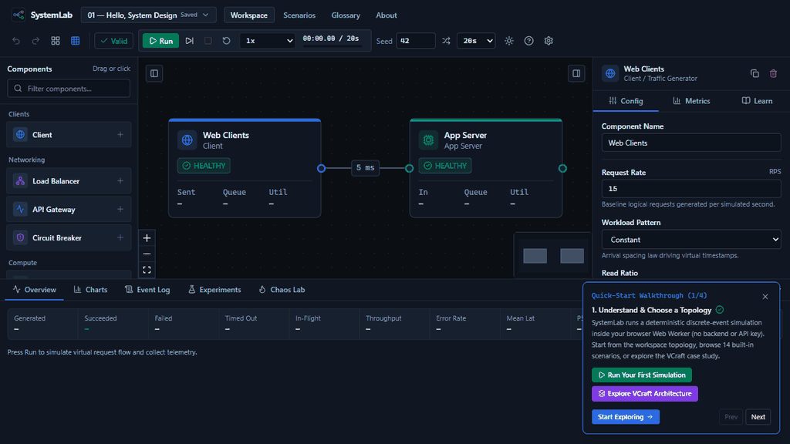

# SystemLab

**Design. Simulate. Break. Understand.**

An interactive, local-first distributed systems and discrete-event simulation (DES) playground built for computer science students, learners, and software engineers.



---

## Quick Start

**Prerequisites:** Python `3.10+`, Node.js `20+` (verified on `v24.14.0`), and npm `10+`.

```bash
git clone https://github.com/Nguyen-XuanTung/SystemLab.git
cd SystemLab
python scripts/run_demo.py
```

Open the official local URL: **`http://localhost:5200/`**.

Useful runner commands:

```bash
python scripts/run_demo.py --status    # Check managed server status and PID
python scripts/run_demo.py --stop      # Gracefully stop only SystemLab's managed process
python scripts/run_demo.py --rebuild   # Force clean production build and start on :5200
python scripts/run_demo.py --dev       # Start Vite HMR dev server on :5200
```

**Alternative manual Node workflow:**

```bash
npm ci
npm run dev       # Starts Vite development server on http://127.0.0.1:5200/
```

- **No AI API required**
- **No backend server required**
- **No Docker required**
- **Local-first storage** (IndexedDB + JSON import/export)

---

## Port Configuration & Multi-Project Isolation

SystemLab binds strictly to loopback (`127.0.0.1`, `strictPort: true`, zero silent port fallback) via [scripts/ports.json](scripts/ports.json) and avoids external project ports (`5173`, `5174`, `15173`, `18080`, `8080`, `3307`):

| Purpose                                                 | Host & Port      | Configured By                                 | Notes                                                       |
| ------------------------------------------------------- | ---------------- | --------------------------------------------- | ----------------------------------------------------------- |
| **Development (`npm run dev` / `--dev`)**               | `127.0.0.1:5200` | `vite.config.ts` (`SYSTEMLAB_DEV_PORT`)       | Do not run simultaneously with preview demo on `:5200`      |
| **Official Local Demo (`scripts/run_demo.py`)**         | `127.0.0.1:5200` | `scripts/ports.json` (`SYSTEMLAB_DEMO_PORT`)  | Serves static production `dist/` via Vite preview           |
| **Standalone Production Preview (`npm run preview`)**   | `127.0.0.1:5201` | `vite.config.ts` (`SYSTEMLAB_PREVIEW_PORT`)   | Separate from `:5200` demo runner                           |
| **Playwright E2E Isolated Server (`npm run test:e2e`)** | `127.0.0.1:5202` | `playwright.config.ts` (`SYSTEMLAB_E2E_PORT`) | `reuseExistingServer: false` — never reuses unknown servers |

---

## Overview & Why SystemLab Exists

1. **Static diagrams cannot show dynamics:** Drawing a Load Balancer or Cache in a diagramming tool does not reveal how tail latency reacts when database connection pools saturate or cache hit ratios drop.
2. **Production clusters are slow for conceptual iteration:** Spinning up containers and load generators takes minutes per topology change; SystemLab executes discrete-event simulations deterministically in milliseconds inside a browser Web Worker.
3. **Reproducibility matters:** Every experiment records its topology, random seed, horizon, engine version, and fault schedule so configurations can be compared fairly side-by-side.


---

## Core Features

- **Pure Deterministic DES Engine (`src/engine/`):** Monotonic `VirtualClock`, `(timestampMs, priority, sequence)` tie-breaking on a binary `MinHeap`, exact time-weighted utilization integrals, R-7 percentile interpolation, and strict logical request conservation (`generated === succeeded + failed + timedOut + inFlight`).
- **10 Simulated Component Models:** Client / Traffic Generator (`constant`, `poisson`, `bursty`, `ramp`, `step`), Load Balancer (`round_robin`, `random`, `least_in_flight`, health-aware), API Gateway (Token Bucket rate limiter + read/write split), Application Server (bounded worker pool + FIFO queue + bounded retries), Probabilistic Cache, Primary Database, Message Queue (`async_ack` / `sync_wait`), Background Worker, Circuit Breaker (`CLOSED` / `OPEN` / `HALF-OPEN`), and Read Replica.
- **Architecture Graph Editor (`@xyflow/react`):** Drag-and-drop & click-to-add palette, directional links with latency/route labels, Dagre auto-layout, snap-to-grid, 50-step undo/redo, context menu, and DAG validation.
- **Real-Time Telemetry & Request Tracing:** Live KPIs (`Mean`, `P50`, `P95`, `P99`, showing `—` at zero samples), sortable node table, Recharts virtual-time charts, bounded 500-event log, and hop-by-hop Request Trace modal.
- **Chaos Lab Fault Injection:** Manual live fault injection/recovery and scheduled timelines (`node_failure`, `latency_spike`, `capacity_drop`, `traffic_spike`, `packet_drop`, `cache_cold_start`, `edge_latency_spike`, `edge_failure`).
- **Experiment Studio:** Save immutable snapshots in IndexedDB, compare Baseline vs. Candidate deltas, and receive automatic fairness notices if seeds, horizons, client rates, or `traffic_spike` schedules differ.
- **Safe Local Persistence:** IndexedDB storage via Dexie with memory fallback banner and Zod-validated JSON import/export (2 MB cap, 64-level depth guard, prototype-pollution key stripping).


---

## VCraft — Real-World Architecture Case Study

SystemLab includes a dedicated 4-part case study modeled after [`Nguyen-XuanTung/vcraft-XUANTUNG`](https://github.com/Nguyen-XuanTung/vcraft-XUANTUNG/tree/TungBeng) (branch `TungBeng`):

| ID     | Scenario                                | Architecture Type   | Focus                                                                   |
| ------ | --------------------------------------- | ------------------- | ----------------------------------------------------------------------- |
| `VC-1` | VCraft — Current Architecture           | Verified Current    | Steady 60 RPS flow across Nginx SPA Proxy → Spring Boot → MySQL 8.4     |
| `VC-2` | VCraft — Peak Traffic                   | Verified Current    | 3x craft-fair surge saturating backend & DB connection pools            |
| `VC-3` | VCraft — Scaled Architecture (Proposed) | **Proposed Scaled** | Hypothetical LB + 2× Spring Boot + Public Read Cache comparison         |
| `VC-4` | VCraft — Failure & Recovery             | Verified Current    | Backend capacity drop, DB slowdown, single-instance crash, and recovery |

> **Educational Simulation Notice:** The VCraft case study is an **educational simulation** inside SystemLab. Traffic rates, service latencies, pool capacities, and proposed scaling topologies are illustrative simulation assumptions rather than verified production VCraft telemetry. Real horizontal scaling of VCraft also depends on shared storage for `uploads`/`private_evidence`, per-request `users.active` DB checks, and `PESSIMISTIC_WRITE` row locks. Read the full analysis in [VCraft Case Study](docs/case-studies/VCRAFT_ARCHITECTURE.md).





---

## Core Built-in Scenarios (`01`–`10`)

| #   | Scenario                     | Focus                                                                   |
| --- | ---------------------------- | ----------------------------------------------------------------------- |
| 01  | Hello, System Design         | Arrival rate, fixed service time, utilization, and request lifecycle    |
| 02  | Horizontal Scaling           | Round-Robin vs. Least-In-Flight distribution across 3 app servers       |
| 03  | Caching Fundamentals         | Probabilistic cache hit impact on database utilization and P95 latency  |
| 04  | Database Bottleneck          | How narrow DB connection pools bottleneck stateless application scaling |
| 05  | Rate Limiting                | Token Bucket load shedding during periodic traffic bursts               |
| 06  | Asynchronous Processing      | `async_ack` HTTP response latency vs. background worker job completion  |
| 07  | Traffic Spike & Backpressure | Step-load spike crossing cluster capacity and bounded queue drops       |
| 08  | Server Failure & Recovery    | Scheduled server crash, health-aware failover, and recovery             |
| 09  | Circuit Breaker Protection   | `CLOSED -> OPEN -> HALF-OPEN -> CLOSED` resilience transitions          |
| 10  | Read / Write Split           | API Gateway routing reads to Read Replicas and writes to Primary DB     |

---

## Simulation Architecture & Reproducibility

- `src/engine/` — Pure TypeScript DES kernel (`VirtualClock`, `MinHeap`, `SeededRng` `SplitMix32` -> `xoshiro128**`, zero React/DOM/`Math.random` imports enforced via ESLint).
- `src/workers/` — ES Module Web Worker (`simulation.worker.ts`) with monotonic `runId` fencing and automatic main-thread fallback.
- `src/store/`, `src/schemas/`, `src/features/` — Zustand stores, Zod schemas (`schemaVersion: 1`), Dexie IndexedDB persistence, React Flow canvas, Telemetry, Chaos Lab, Experiments, and Scenarios.

Changing UI playback speed (`0.25x` to `Fast-Run`) or telemetry batch size only paces wall-clock rendering and never alters simulated timestamps or random draws. See [Architecture Documentation](docs/architecture/ARCHITECTURE.md) and [Simulation Validation](docs/verification/SIMULATION_VALIDATION.md).

---

## Reproducible Benchmarks

Measured locally on Windows 11 (`Node v24.14.0`, `1 warmup + 5 timed runs` per case, distinct deterministic seeds `42`/`101`/`202`/`303`/`404`/`505`):

| Workload                       | Topology         | Median Wall Time (Min–Max)   | DES Throughput       | Virtual Workload Rate |
| ------------------------------ | ---------------- | ---------------------------- | -------------------- | --------------------- |
| 1,000 requests (10s)           | 2 nodes, 1 edge  | 5.40 ms (4.15–6.64 ms)       | 703,459 events/sec   | 99.6 sim req/s        |
| 10,000 requests (10s)          | 6-node 3-tier    | 58.95 ms (55.88–74.76 ms)    | 1,209,870 events/sec | 1,011.2 sim req/s     |
| 100,000 requests (40s stretch) | 6-node 3-tier    | 709.34 ms (524.59–914.56 ms) | 1,023,249 events/sec | 2,506.5 sim req/s     |
| 5,000 requests (10s)           | 25-node, 43-edge | 30.59 ms (29.67–38.46 ms)    | 1,331,976 events/sec | 501.9 sim req/s       |

> **Metric note:** `DES Throughput (events/sec)` measures in-memory discrete-event kernel execution in Node; `Virtual Workload Rate (sim req/s)` measures simulated model-time arrival rate. **Neither figure represents production HTTP server RPS.** See [Performance Report](docs/verification/PERFORMANCE_REPORT.md) for failure/recovery, queue saturation, IQR, and 20-iteration `WorkerSessionRunner` checks.

---

## Testing & Verification

```bash
npm run lint           # ESLint + strict src/engine/ purity checks
npm run format:check   # Prettier formatting check across src/ and tests/
npm run typecheck      # Strict TypeScript checking
npm run test:runner    # Python unittest suite for scripts/run_demo.py process & port safety
npm run test:coverage  # Vitest unit, analytical (Tests A-H), invariant, schema & integration + V8 coverage
npm run test:e2e       # Playwright E2E suite on isolated port 5202 (Chrome / PLAYWRIGHT_CHANNEL=msedge)
npm run benchmark      # Multi-run deterministic DES benchmarks
npm run build          # Typecheck + production Vite bundle
```

Verification reports: [Test Report](docs/verification/TEST_REPORT.md) · [Simulation Validation](docs/verification/SIMULATION_VALIDATION.md) · [Security Review](docs/verification/SECURITY_REVIEW.md) · [Independent Release Audit](INDEPENDENT_RELEASE_AUDIT.md).

---

## Known Limitations

SystemLab is an **educational simulation playground**, not a production capacity planner or load-testing replacement. Key abstractions include DAG-only forwarding (bounded local app-server retries), probabilistic cache hit trials (no key-level LRU eviction or Zipfian keys), open-loop client traffic, and abstract static network latencies (no TCP/TLS modeling). Read [Known Limitations](docs/KNOWN_LIMITATIONS.md).

---

## Deployment

SystemLab builds to pure static assets (`dist/`) with zero backend or localhost dependencies:

- **Target GitHub Pages URL:** `https://nguyen-xuantung.github.io/SystemLab/` (configured via `.github/workflows/deploy-pages.yml` using `VITE_BASE_PATH=/SystemLab/`).
- **Local subpath verification:** See [Deployment Guide](docs/guides/DEPLOYMENT_GUIDE.md).

---

## Contributing & License

Contributions are welcome — see [CONTRIBUTING.md](CONTRIBUTING.md) and [SECURITY.md](SECURITY.md).  
Released under the [MIT License](LICENSE).
