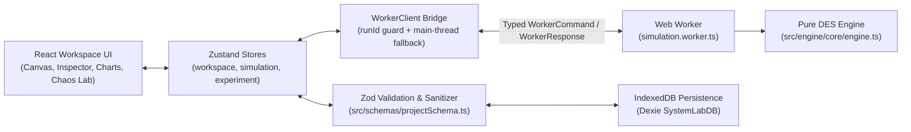
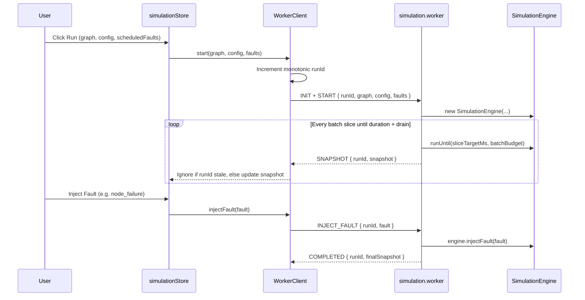

# System Architecture — SystemLab

**Design. Simulate. Break. Understand.**

---

## 1. Architectural Overview

SystemLab uses a clean **three-layer local-first architecture** running entirely in the browser:

1. **Simulation Core (`src/engine/`):** Pure TypeScript discrete-event simulation (DES) kernel. Zero imports from React, DOM, Web Workers, Zustand, or IndexedDB. Deterministic seeded PRNG (`SeededRng`) and monotonic `VirtualClock` guarantee bit-identical output across Node tests, Node benchmarks, and browser sessions.
2. **Execution Bridge & State (`src/workers/`, `src/store/`, `src/schemas/`, `src/features/persistence/`):** Typed message-passing Web Worker runs `SimulationEngine` in bounded batches, emits ~20 Hz throttled telemetry snapshots stamped with monotonic `runId`, and persists versioned projects and experiment snapshots locally in IndexedDB via Dexie.
3. **Developer Workspace UI (`src/app/`, `src/components/`, `src/features/`):** React 19 + `@xyflow/react` canvas editor, semantic property inspector, Recharts telemetry charts, bounded event log with request trace inspection, Chaos Lab fault timeline, Experiment Studio comparison, Scenario Library, and Glossary.

---

## 2. System Component Diagram

---

## 3. Simulation Run Sequence

---

## 4. Module Boundaries & Dependency Rules

| Module | Allowed Dependencies | Forbidden Dependencies |
|---|---|---|
| `src/engine/**` | Pure TypeScript + standard JS (`Math`, `Map`, `Set`) | `react`, `react-dom`, `window`, `document`, `setTimeout`, `Math.random`, `zustand`, `dexie`, `@xyflow/react` |
| `src/schemas/**` | `zod`, `src/engine/models/types` | React, DOM, Dexie |
| `src/workers/**` | `src/engine/**`, Web Worker `self` API | React, DOM (`document`), Zustand |
| `src/features/persistence/**` | `dexie`, `src/schemas/**`, `src/engine/models/types` | React UI components |
| `src/store/**` | `zustand`, `src/engine/**`, `src/workers/workerClient`, `src/features/persistence/**` | JSX components |
| `src/features/**`, `src/components/**` | React, Radix UI, Lucide, Recharts, `@xyflow/react`, `src/store/**` | Direct mutation of engine internals |

ESLint enforces `src/engine/**` purity via `no-restricted-imports`, `no-restricted-globals`, and `no-restricted-properties`.

---

## 5. Memory & Performance Guardrails

- **Bounded Event Stream:** Ring buffer capped at **500** recent entries (`EventLogEntry[]`).
- **Bounded Trace History:** Last **200** completed/active request traces retained for hop-by-hop inspection.
- **Bounded Time-Series:** Dynamic bucket width (`max(250ms, ceil(durationMs / 240))`) capped at **600** points.
- **Bounded Latency Reservoir:** **50,000** samples max via seeded Algorithm R on a forked PRNG stream (does not perturb simulation traffic RNG).
- **Engine Safety Ceilings:** Configurable `maxEvents` (default `500,000`), `maxZeroTimeEvents` (`10,000`), `maxHops` (`64`), and `maxInFlight` (`100,000`) abort pathological configs cleanly with diagnostic messages.
