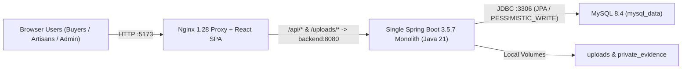
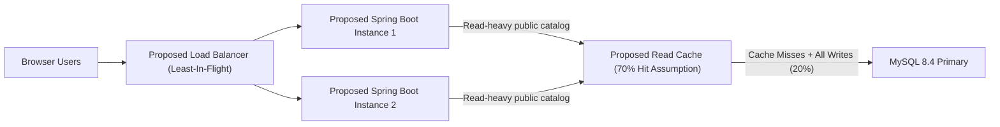
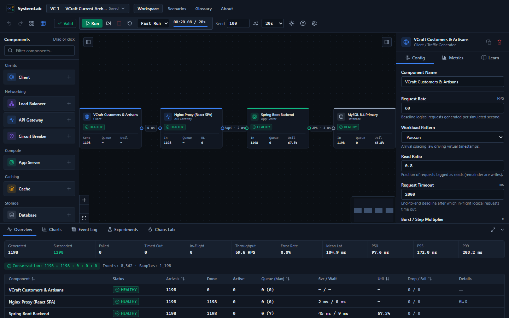
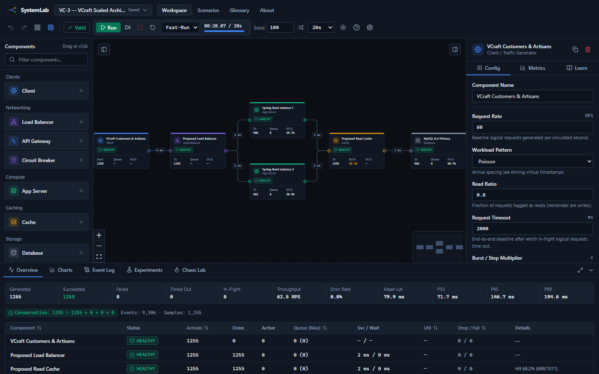
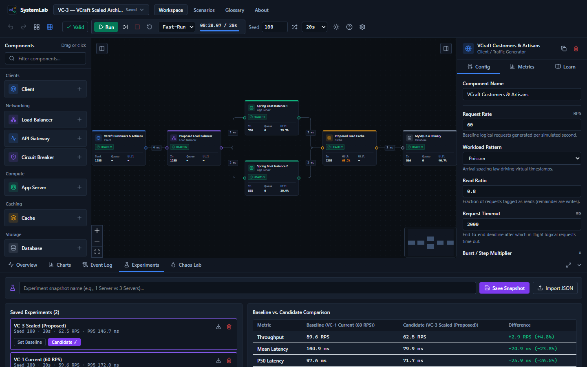

# VCraft — Real-World Architecture Case Study

> **Important Disclaimer:** This case study is an **educational simulation model** built inside SystemLab based on the public/verified structure of **vCraft · Làng nón Chuông**. All traffic arrival rates, service latencies, database pool limits, and fault schedules are **illustrative simulation assumptions**—not production benchmarks or load-test measurements of the real VCraft application.

---

## 1. VCraft Overview

**vCraft** (_vCraft · Làng nón Chuông_) is a full-stack craft-village commerce, origin traceability, quote-bidding, and B2B order allocation platform supporting conical-hat artisans in Chuông Village (Thanh Oai, Hanoi).

- **Verified Reference Repository:** [`Nguyen-XuanTung/vcraft-XUANTUNG`](https://github.com/Nguyen-XuanTung/vcraft-XUANTUNG)
- **Verified Reference Branch:** [`TungBeng`](https://github.com/Nguyen-XuanTung/vcraft-XUANTUNG/tree/TungBeng) (verified at commit `de45501faed3874d3d0bd5d2051e416680f3ecc7`)

---

## 2. Verified Current Architecture (`vcraft-XUANTUNG@TungBeng`)

Inspection of `docker-compose.yml`, `docker/frontend.Dockerfile`, `frontend/vite.config.js`, `backend/pom.xml`, `backend/src/main/resources/application.properties`, `TECH_STACK.md`, `docs/API_CONTRACT.md`, and `docs/VCRAFT_FINAL_ARCHITECTURE_SPEC_V3.md` confirms the following **actual deployed stack**:

| Layer                           | Verified Implementation                                                                                                                                                                                                                                                                                                                                        | Source Reference                                             |
| ------------------------------- | -------------------------------------------------------------------------------------------------------------------------------------------------------------------------------------------------------------------------------------------------------------------------------------------------------------------------------------------------------------- | ------------------------------------------------------------ |
| **Browser UI (SPA)**            | React + JavaScript/JSX + Vite + Bootstrap 5 + React Router + Leaflet/OpenStreetMap                                                                                                                                                                                                                                                                             | `TECH_STACK.md`, `frontend/vite.config.js`                   |
| **Reverse Proxy & Static Edge** | `nginx:1.28-alpine` container (`:80` mapped to `127.0.0.1:5173`), `client_max_body_size 26m`, serving static Vite `dist/` and proxying `/api/` and `/uploads/` to `http://backend:8080`                                                                                                                                                                        | `docker/frontend.Dockerfile`, `docker-compose.yml`           |
| **Application Backend**         | Single Java 21 + Spring Boot `3.5.7` monolith (`vn.vcraft:vcraft:1.0.0`, internal port `8080`), Spring Web REST API, Spring Security + OAuth2 Resource Server JWT + BCrypt, Spring Data JPA (`ddl-auto=validate`, `open-in-view=false`), ZXing `3.5.3` (QR PNG), Thumbnailator `0.4.20`, Springdoc OpenAPI `2.8.13`                                            | `backend/pom.xml`, `application.properties`                  |
| **Relational Database**         | `mysql:8.4` (`db:3306` internal, `127.0.0.1:3307` host admin) across 16 tables (`users`, `artisan_profiles`, `village_landmarks`, `products`, `product_images`, `material_lots`, `production_batches`, `batch_material_usages`, `production_steps`, `quote_requests`, `quote_request_artisans`, `bids`, `bid_comments`, `orders`, `order_allocations`, `news`) | `docker-compose.yml`, `VCRAFT_FINAL_ARCHITECTURE_SPEC_V3.md` |
| **File Storage Volumes**        | Two separate backend volumes: `uploads` (`/app/uploads`, public product/batch images) and `private_evidence` (`/app/private-evidence`, supplier invoices gated by JWT via `GET /api/material-lots/{id}/private-evidence/{evidenceId}`)                                                                                                                         | `docker-compose.yml`, `API_CONTRACT.md`                      |
| **Concurrency & Integrity**     | `@Transactional` + JPA `PESSIMISTIC_WRITE` row locks on stock reservation, bid acceptance, B2B order allocation/transfer, and batch completion; optimistic `expectedVersion`/`expectedStock` + idempotent `operationKey`                                                                                                                                       | `VCRAFT_FINAL_ARCHITECTURE_SPEC_V3.md`, `API_CONTRACT.md`    |

**Explicitly NOT present in verified current VCraft (`TECH_STACK.md` §1.2):**

- No Redis or external distributed cache
- No Load Balancer or multiple backend replicas
- No Kafka / RabbitMQ / WebSocket broker
- No JWT refresh tokens (every authenticated request checks `users.active` in MySQL)

---

## 3. Architecture Diagrams: Verified Current vs. Proposed Scaled

> **Strict Separation:** The first diagram below depicts VCraft's **verified actual implementation**; the second depicts a **hypothetical scaling exercise** inside SystemLab and does **not** exist in the VCraft codebase.

### 3.1 Verified Current Architecture (`VC-1`, `VC-2`, `VC-4`)

### 3.2 Proposed Hypothetical Scaled Architecture (`VC-3`)

---

## 4. SystemLab Simulation Mapping & Workload Assumptions

| Real VCraft Component                     | SystemLab Component                        | Configured Simulation Parameters (**Assumptions**)                                                                      |
| ----------------------------------------- | ------------------------------------------ | ----------------------------------------------------------------------------------------------------------------------- |
| Browser Customers / Artisans              | `client` (`VCraft Customers & Artisans`)   | `60 RPS`, `poisson` arrivals, `readRatio = 0.8` (80% catalog/QR reads, 20% writes), `timeoutMs = 2000`                  |
| Nginx `1.28-alpine` Proxy + React SPA     | `api_gateway` (`Nginx Proxy (React SPA)`)  | `processingLatencyMs = 2 ms`, pass-through routing, `rateLimitEnabled = false`                                          |
| Single Spring Boot `3.5.7` Monolith       | `app_server` (`Spring Boot Backend`)       | `concurrency = 4`, `queueCapacity = 45`, `serviceTimeMs = 45 ms` (`lognormal`, `cv = 0.4`)                              |
| `mysql:8.4` Primary                       | `database` (`MySQL 8.4 Primary`)           | `maxConnections = 3`, `queueCapacity = 40`, `readLatencyMs = 25 ms`, `writeLatencyMs = 65 ms` (`lognormal`, `cv = 0.4`) |
| _Hypothetical LB (`VC-3` only)_           | `load_balancer` (`Proposed Load Balancer`) | `strategy = least_in_flight`, `processingLatencyMs = 2 ms`, `healthCheckEnabled = true`                                 |
| _Hypothetical Public Cache (`VC-3` only)_ | `cache` (`Proposed Read Cache`)            | `lookupLatencyMs = 3 ms`, `hitProbability = 0.7`, `writePolicy = bypass`                                                |

All four scenarios use **`seed = 100`**, **`durationMs = 20,000` (20s)**, and **`drainOnEnd = true` (`maxDrainMs = 10,000`)**.

---

## 5. Scenario Breakdown

### Scenario A — `VC-1: VCraft — Current Architecture` (`verified_current`)

Models the single-instance verified stack under steady 60 RPS traffic. Spring Boot sustains `~88.9 RPS` theoretical max (`4 / 0.045s`) and MySQL sustains `~90.9 RPS` mixed (`0.8 * 25 + 0.2 * 65 = 33 ms` mean => `3 / 0.033s`), leaving healthy headroom.

### Scenario B — `VC-2: VCraft — Peak Traffic` (`verified_current`)

Applies the exact `VC-1` topology with a scheduled **`traffic_spike` (3x rate = 180 RPS from `t=5s` to `t=13s`)** simulating a holiday craft-fair surge. Both the Spring Boot worker pool and MySQL connection pool saturate, causing queue exhaustion (`45/45` dropped requests) and P95 latency spikes.

### Scenario C — `VC-3: VCraft — Scaled Architecture (Proposed)` (`proposed_scaled`)

Evaluates a **hypothetical scaling proposal**: Least-In-Flight Load Balancer, two Spring Boot backend instances (same per-instance config as `VC-1`), and a read-through cache targeting public read endpoints (`70%` cache hit probability, write-bypass). Uses the exact same client rate (`60 RPS`), seed (`100`), and duration (`20s`) as `VC-1` so Experiment Studio produces **zero fairness warnings**.

### Scenario D — `VC-4: VCraft — Failure & Recovery` (`verified_current`)

Applies three scheduled in-simulator faults to `VC-1` (never touching real VCraft):

1. `t=3s..7s`: `capacity_drop` (`0.5`) on Spring Boot Backend
2. `t=7s..11s`: `latency_spike` (`+140 ms`) on MySQL 8.4 Primary
3. `t=12s..15s`: `node_failure` (complete SPOF outage) on Spring Boot Backend -> automatic recovery by `t=15s`.

---

## 6. How to Reproduce Comparisons in SystemLab

1. Launch SystemLab (`python scripts/run_demo.py`) and open `http://localhost:5200/`.
2. Open **Scenarios → VCraft Case Study**, load **`VC-1 — VCraft Current Architecture`**, switch speed to **Fast-Run**, press **Run**, open **Experiments**, and save as **`VC-1 Current`**.
3. Open **Scenarios**, load **`VC-3 — VCraft Scaled Architecture (Proposed)`**, press **Reset** / **Run** (`Fast-Run`), save in **Experiments** as **`VC-3 Scaled`**.
4. Inspect the **Baseline vs. Candidate Comparison** table and chart (zero fairness warnings because seed, horizon, and client workload match).
5. Repeat with **`VC-2 — VCraft Peak Traffic`** vs. **`VC-1`** (observe the automatic `traffic_spike` fairness notice) and **`VC-4 — VCraft Failure & Recovery`** vs. **`VC-1`**.

---

## 7. Actual Observed Simulation Results (`Seed = 100`, `20s`)

Executed directly via `SimulationEngine` (`runToCompletion()`):

| Scenario                   | Generated | Succeeded | Failed | Timed Out | Throughput    | Error Rate | Mean Lat | P50 Lat  | P95 Lat        | P99 Lat    | Backend Util (Max Q)  | MySQL Util (Max Q) |
| -------------------------- | --------- | --------- | ------ | --------- | ------------- | ---------- | -------- | -------- | -------------- | ---------- | --------------------- | ------------------ |
| **VC-1 Current**           | 1,198     | 1,198     | 0      | 0         | **59.64 RPS** | 0.00%      | 104.9 ms | 97.6 ms  | **172.0 ms**   | 203.2 ms   | 67.3% (7)             | 65.8% (6)          |
| **VC-2 Peak (3x)**         | 2,200     | 1,444     | 756    | 0         | **72.13 RPS** | **34.36%** | 424.2 ms | 585.5 ms | **814.6 ms**   | 908.4 ms   | 80.9% (45)            | 80.6% (35)         |
| **VC-3 Scaled (Proposed)** | 1,255     | 1,255     | 0      | 0         | **62.53 RPS** | 0.00%      | 79.9 ms  | 71.7 ms  | **146.7 ms**   | 194.6 ms   | 39.7% / 30.9% (3 / 2) | **40.7%** (4)      |
| **VC-4 Failure & Rec.**    | 1,237     | 804       | 389    | 44        | **40.10 RPS** | **35.00%** | 408.3 ms | 137.5 ms | **1,637.5 ms** | 1,950.8 ms | 76.1% (45)            | 62.9% (40)         |

_(Methodological transparency note: Total Poisson arrival count varies slightly from `1,198` in `VC-1` to `1,255` in `VC-3` because `SimulationEngine` shares one seeded PRNG stream across client inter-arrival draws and downstream service/cache draws—every run remains 100% deterministic for its graph and seed.)_

---

## 8. Engineering Interpretation

1. **Steady-State Headroom (`VC-1`):** At 60 RPS (`67.3%` app util, `65.8%` DB util), the single-container monolith handles traffic cleanly with zero queue overflow.
2. **Saturation Under Surge (`VC-2`):** Doubling/tripling traffic during a promotional peak (`180 RPS`) exceeds Spring Boot's `~88.9 RPS` ceiling, filling the 45-slot app queue (`756` dropped requests, `34.36%` failure rate, `P95` jumping `4.7x` from `172.0 ms` to `814.6 ms`).
3. **Cache Offloading & Horizontal Compute (`VC-3`):** Adding a public-read cache (`68.2%` realized hit ratio in simulation) cuts MySQL arrivals from `1,198` to `566`, lowering MySQL utilization from `65.8%` to `40.7%` and reducing P95 latency from `172.0 ms` to `146.7 ms`.
4. **SPOF Impact (`VC-4`):** Because `VC-1` runs one backend instance behind Nginx, a 3-second Spring Boot failure drops throughput to `40.10 RPS` and raises overall P95 above `1.6s` until recovery completes at `t=15s`.

---

## 9. Model Limitations & Real-World VCraft Scaling Considerations

In addition to general SystemLab limitations ([Known Limitations](../KNOWN_LIMITATIONS.md)), **scaling the real VCraft platform cannot stop at adding containers and a cache**:

1. **Shared Media & Private Evidence Storage:** VCraft currently mounts local Docker named volumes (`uploads` and `private_evidence`) to a single backend container. Running 2+ Spring Boot instances requires shared POSIX storage (NFS/EFS) or S3-compatible object storage so uploaded images and JWT-gated invoices remain accessible from every instance.
2. **Per-Request DB Authentication Check (`users.active`):** VCraft deliberately validates `users.active` in MySQL on privileged requests rather than trusting stateless JWTs alone so admin suspensions revoke access immediately. Either keep DB reads fast with proper indexing or introduce explicit cache invalidation on deactivation.
3. **Non-Cacheable Write & Lock Paths:** Product stock updates (`expectedStock`), direct checkout stock reservation, quote bid acceptance, B2B order allocation/transfer, and batch completion rely on MySQL **`PESSIMISTIC_WRITE`** row locks inside `@Transactional` boundaries. These operations **must never be cached** and remain serialized on the MySQL primary.
4. **Browser CORS & URL Consistency:** All public `/api/*` and `/uploads/*` requests currently proxy through one Nginx origin (`http://localhost:5173`); any multi-instance upstream behind Nginx must preserve sticky-free stateless JWT routing and client upload size limits (`26m`).
